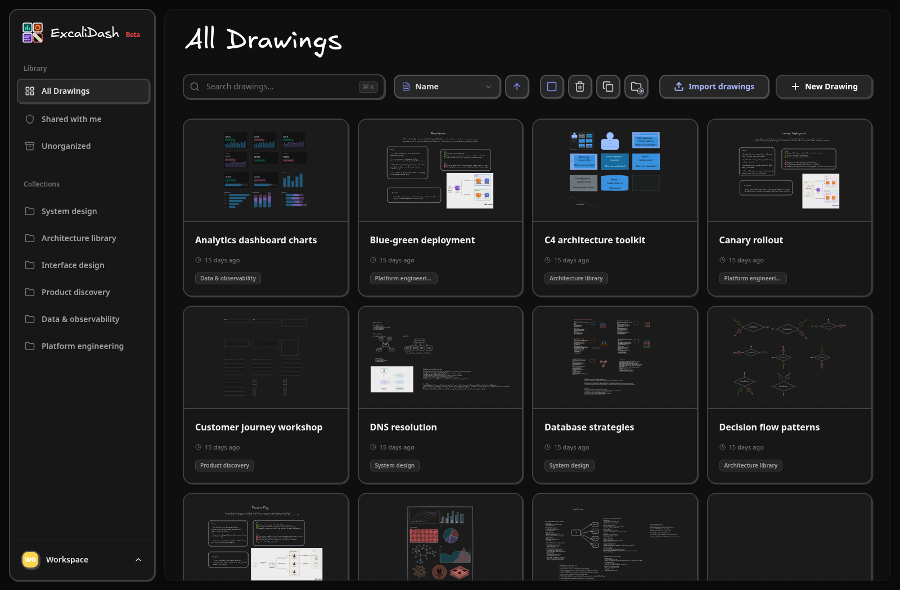

# ExcaliDash

ExcaliDash is an open-source (LGPL-3.0) self-hosted Excalidraw workspace and Excalidraw+ alternative. It wraps the Excalidraw editor with persistent server-side storage, collections, built-in real-time collaboration, version history, and OIDC SSO in one Docker Compose stack, without running `excalidraw-room` or maintaining a custom frontend build.

The official `excalidraw/excalidraw` Docker image is a static frontend: scenes live only in browser localStorage, there are no accounts or folders, and live collaboration points to public servers unless you build and wire up a separate `excalidraw-room` backend.

[](https://excalidash.xyz)

## Quick start

```sh
git clone https://github.com/ZimengXiong/ExcaliDash.git
cd ExcaliDash
docker compose -f docker-compose.prod.yml up -d
```

Open <http://localhost:6767> and create your administrator account.

All you need is Docker with Docker Compose v2. Multi-arch images for `linux/amd64` and `linux/arm64` are published on Docker Hub as `zimengxiong/excalidash-frontend` and `zimengxiong/excalidash-backend`, tagged `latest` and by release (current: `0.7.0`, matching [`VERSION`](VERSION)). Host port `6767` maps to the frontend container on `8080`, while the backend stays internal on port `8000`. Drawings save to SQLite in the `backend-data` volume by default (or PostgreSQL), pasted images stay in the database or offload to any S3-compatible bucket, and live collaboration room state lives in one Node.js process so the backend runs as a single replica (`replicas: 1`).

## Excalidraw vs ExcaliDash

| Capability              | Official `excalidraw/excalidraw` | Official + `excalidraw-room`       | Excalidraw+       | ExcaliDash                          |
| ----------------------- | -------------------------------- | ---------------------------------- | ----------------- | ----------------------------------- |
| Hosting                 | Self-hosted static frontend      | Self-hosted, custom frontend build | Hosted SaaS only  | Self-hosted Docker Compose          |
| Saved drawings          | Browser `localStorage`           | Browser `localStorage`             | Cloud workspace   | SQLite or PostgreSQL, optional S3   |
| Real-time collaboration | Public Excalidraw servers        | Your `excalidraw-room` server      | Yes               | Built-in Socket.IO on `/socket.io/` |
| Accounts, folders, SSO  | No                               | No                                 | Yes               | Local accounts, collections, OIDC   |
| Version history         | No                               | No                                 | Yes               | Automatic snapshots with restore    |
| License and cost        | MIT, free                        | MIT, free                          | Paid subscription | LGPL-3.0, free                      |

## Documentation

Full documentation lives at [excalidash.xyz](https://excalidash.xyz). Start with the [self-hosting guide](https://excalidash.xyz/guides/self-host-excalidraw) or [production Docker Compose setup](https://excalidash.xyz/deploy/docker) if you want pinned tags, scheduled SQLite backups, and upgrades, or jump straight to [Coolify, Portainer, and Dokploy](https://excalidash.xyz/deploy/coolify-portainer) or [Kubernetes, Proxmox, and Unraid](https://excalidash.xyz/deploy/kubernetes-proxmox-unraid).

For production infrastructure, see the guides for [reverse proxies, HTTPS, and WebSockets](https://excalidash.xyz/guides/excalidraw-reverse-proxy) (Caddy, Nginx, Nginx Proxy Manager, Traefik, Cloudflare Tunnel), [native OIDC SSO](https://excalidash.xyz/guides/excalidraw-oidc-sso) (Authentik, Keycloak, Pocket ID, Authelia, Entra ID), [PostgreSQL and S3/R2/MinIO storage](https://excalidash.xyz/guides/excalidraw-postgresql-s3), and the [environment variables reference](https://excalidash.xyz/reference/environment).

If you are still evaluating options or debugging the official image, read [how ExcaliDash works](https://excalidash.xyz/guides/how-excalidash-works), [why the official Excalidraw Docker image does not save drawings](https://excalidash.xyz/guides/excalidraw-docker-not-saving), [running `excalidraw-room` without rebuilding the frontend](https://excalidash.xyz/guides/excalidraw-collaboration-server), [ExcaliDash as a self-hosted Excalidraw+ alternative](https://excalidash.xyz/guides/excalidraw-plus-alternative), or [self-hosted Excalidraw projects compared](https://excalidash.xyz/guides/self-hosted-excalidraw-projects).

ExcaliDash is an independent open-source project built around Excalidraw and is not affiliated with Excalidraw. Licensed under the GNU Lesser General Public License v3.0.
